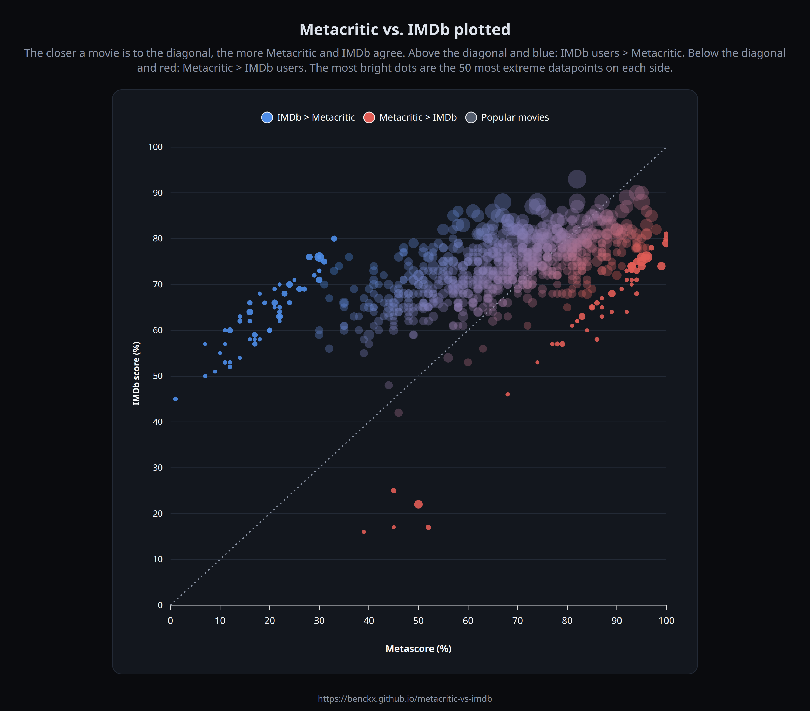

# About

What kind of movies do you prefer? Are you more of a refined hipster or do you favor popular success? This dashboard
explores movies where Metacritic critics and IMDb users disagree.



# Data sources

- **IMDb**: official [datasets](https://datasets.imdbws.com/)
  (`title.ratings.tsv`, `title.basics.tsv`), not committed — fetch them with
  `./fetch_imdb.sh`.
- **Metacritic**: critic scores fetched from the site's
  backend API into `metacritic.jsonl`, not committed — fetch them with
  `python3 fetch_metacritic.py`.

Movies are joined on the IMDb id embedded in Metacritic image paths, with an unambiguous title + year fallback. When no
eligible exact-year match exists, an unambiguous eligible match one year earlier or later may be used. The later year is
displayed when sources disagree. Movies with fewer than 10,000 IMDb votes or fewer than 7 critic reviews are excluded
from the rankings. The dashboard also excludes movies released before 1980 and movies without a year.

## Refreshing the data

To download fresh data and rebuild the rankings and dashboard, run:

```bash
./full_refresh.sh
```

The script requires Bash, `curl`, `gunzip`, Python 3, Pillow (`python3 -m pip install pillow`), and Playwright with
Chromium (see [Exporting visualizations](#exporting-visualizations)). It can be run from any directory and stops
if a step fails. A failed Metacritic download leaves the previous
`metacritic.jsonl` intact; earlier completed steps may still have updated files.
Review the changed data and generated files before committing them.

The individual steps are:

```bash
./fetch_imdb.sh            # download and decompress the IMDb datasets
python3 fetch_metacritic.py  # scrape Metacritic -> metacritic.jsonl
python3 compare.py           # join + rank -> critics_over_users.csv, users_over_critics.csv
python3 render.py          # generate js/data.js and posters/
python3 export_visualizations.py  # export dashboard visualizations to exports/
```

`render.py` downloads each poster it needs once, shrinks it to fit 236×348 WebP
in `posters/` (Metacritic originals are ~2000×3000, ~1 MB), and reuses cached
files afterwards. It requires Pillow (`pip install pillow`). `compare.py` runs
offline. Thresholds are flags on `compare.py`
(`--min-votes`, `--min-reviews`) and constants at the top of `render.py`
(`MIN_YEAR`, `CONTEXT1`, `TOP2`, `CONTEXT2`).

## Exporting visualizations

Install the export tool's browser dependency once:

```bash
python3 -m pip install playwright
python3 -m playwright install chromium
```

The full refresh exports visualizations automatically. To export them separately, run:

```bash
python3 export_visualizations.py
```

This writes six PNGs to `exports/`, one per visualization, including its title, any description, and the dashboard URL.
Images use a 1200-pixel browser viewport and 3x resolution. The two rankings include the initial top 10 movies. About
and the consensus gallery are not exported. Use `--output /path/to/images` to choose another destination. Existing
images with the same names are overwritten. The script works from any directory and needs internet access to load the
dashboard's existing ApexCharts CDN dependency. Charts, fonts, and poster images finish loading before capture; loading
errors stop the export. Poster detail remains limited by the cached 236x348 thumbnails.

Exportable sections in `index.html` use `data-export` attributes for stable filenames. Chart sections wrap their
headings, descriptions, and cards together.

## Files

| File                                                | Role                                                                                      |
|-----------------------------------------------------|-------------------------------------------------------------------------------------------|
| `full_refresh.sh`                                   | run the full refresh pipeline                                                             |
| `fetch_imdb.sh`                                     | download IMDb datasets                                                                    |
| `fetch_metacritic.py`                               | scrape Metacritic scores                                                                  |
| `compare.py`                                        | join datasets, rank discrepancies, write the two CSVs                                     |
| `metacritic.jsonl`                                  | fetched Metacritic movie data (not committed)                                             |
| `critics_over_users.csv`, `users_over_critics.csv`  | ranked movie data                                                                         |
| `render.py`                                         | precompute compact chart inputs into `js/data.js`                                         |
| `export_visualizations.py`                          | export titled dashboard sections as high-resolution PNGs                                  |
| `index.html`                                        | dashboard markup                                                                          |
| `styles.css`                                        | dashboard styles                                                                          |
| `js/common.js`, `js/tables.js`                      | shared helpers and movie rankings                                                         |
| `js/timeline.js`, `js/plotted.js`, `js/category.js` | chart renderers                                                                           |
| `js/consensus.js`                                   | consensus gallery                                                                         |
| `js/dashboard.js`                                   | dashboard initialization and lazy loading                                                 |
| `posters/`                                          | generated, resized poster thumbnails                                                      |
| `js/data.js`                                        | generated, precomputed inputs and shared movie details; supports direct `file://` viewing |
